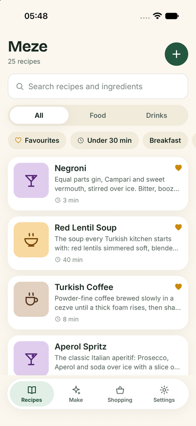
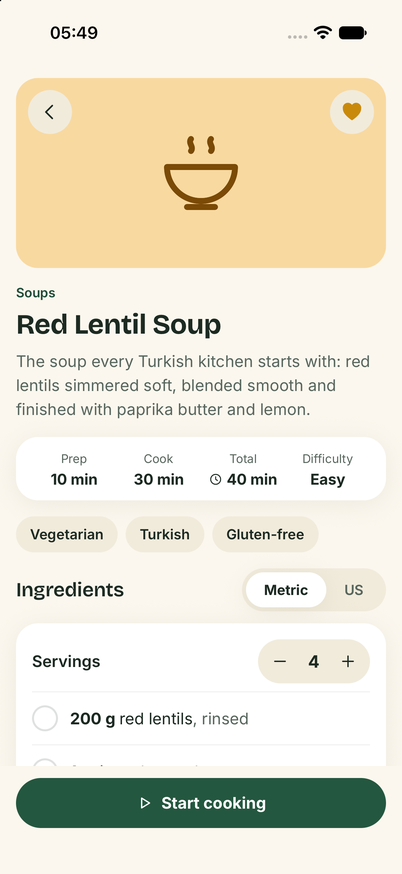
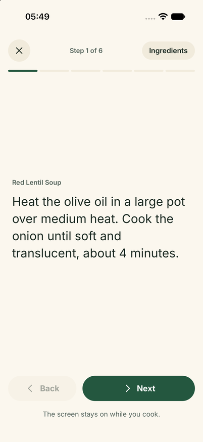
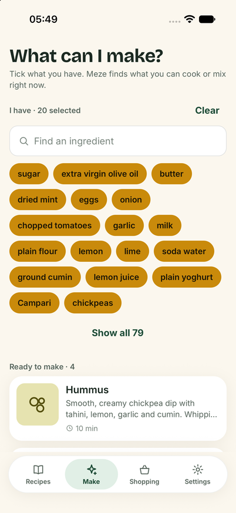
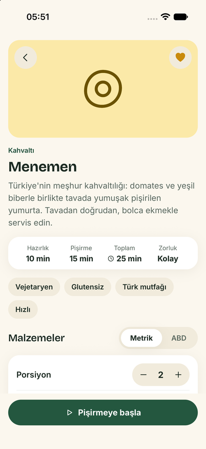
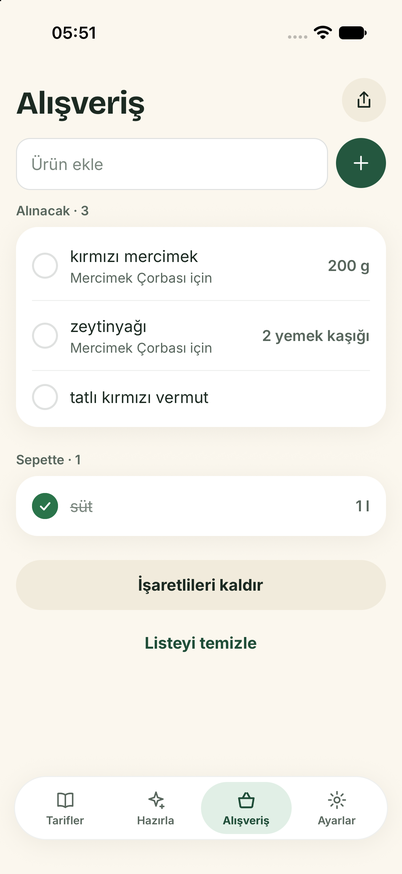

# Meze

A recipe box for food **and** drinks, in English, Turkish and German.

A *meze* is the spread of small plates that comes with a drink — which is the
idea: one place for the lentil soup, the apple cake, the Turkish coffee and the
Negroni. It runs on **iOS and Android** from one Expo codebase, keeps everything
on the phone, and has no account, no ads and no limit on how many recipes you
save.

<p>
  
  
  
  
</p>
<p>
  
  
</p>

## What it does

| | |
|---|---|
| **25 starter recipes** | Fourteen dishes and eleven drinks, each written in all three languages: mercimek çorbası, menemen, kısır, Käsespätzle, Apfelkuchen, hummus, Türk kahvesi, ayran, Glühwein, a Negroni and more. Hide the ones you do not want; bring them back in Settings. |
| **Your own recipes** | Type one in — ingredients one per line, as you would write them, in any of the three languages ("2 EL Olivenöl", "1 yemek kaşığı salça", "1½ cups milk") — and the amounts and units are picked out for you. |
| **Import from a website** | Paste a link. Meze reads the recipe data most recipe sites embed (schema.org JSON-LD) on the phone itself and fills in the form for you to check. |
| **Servings and units, in place** | Change the servings and every amount follows. Switch between metric and US units: grams become ounces and millilitres become cups, while spoons stay spoons and a bartender's centilitres stay centilitres. Amounts are rounded to something you can actually measure. |
| **Cook mode** | One step at a time in large type, with the screen kept awake, a progress bar, the ingredients one tap away, and a timer on every step that involves waiting. |
| **What can I make?** | Tick what is in your cupboard or bar. Meze lists what you can make now, what is one or two things short, and the single purchase that would unlock the most. |
| **Shopping list** | Add a recipe's ingredients — scaled, minus the ones you ticked as already in the house — or type your own. The same thing in the same unit adds up. |
| **Search in every language at once** | "mercimek", "lentil" and "Linsen" find the same soup, and you can leave the dots off: "corbasi" finds "çorbası", "kasespatzle" finds "Käsespätzle". |
| **Nothing locked in** | Export your recipes as JSON, import them on another phone, share any recipe as plain text. |

## Why it is built this way

The category was surveyed before a line was written (November 2026). What that
found, and what Meze does about it:

| Finding | What Meze does |
|---|---|
| Paprika, the long-standing leader, moved to a subscription that caps the free tier at 50 recipes on one device. New AI-import apps cap it at 10 recipes and a handful of imports a month. | No cap on anything, no account, no subscription. |
| The newcomers all lead with AI import from Instagram, TikTok and YouTube — and all meter it, because it runs on their servers and costs them per use. | Not built. It would need a server and an account, which is the opposite of the point. Website import, which runs on the phone, is. |
| Drink apps are built around bar inventory: mark what you own, see what you can mix, see what one bottle would unlock. Recipe managers mostly are not. | **What can I make?** is one matcher for the kitchen and the bar. |
| Cook mode — screen awake, step by step, timers from steps — is now standard, and sometimes sold as a paid extra. | Free, and the first thing on the recipe page. |
| None of the apps checked ships Turkish, English and German together. The ones with German have no Turkish; Yemek.com is Turkish only; the drink apps checked are English only. | All three, for the interface and for every starter recipe. |

The research was narrow and says so: it rests mostly on app-store listings for
a dozen apps, verified nothing about what users praise or complain about in
reviews, and found no evidence on visual design in the category. Many
well-known apps (Mela, Crouton, Pestle, Samsung Food, Cookpad, Chefkoch, Nefis
Yemek Tarifleri) were not covered at all. "Meze" turning up no recipe app in a
store search is not a trademark check.

## Running it

Needs Node.js 22 and, for iOS, Xcode with CocoaPods; for Android, the Android SDK.

```bash
cd meze
npm install
npx expo prebuild        # generates ios/ and android/
npx expo run:ios         # or: npx expo run:android
```

If `npx expo run:ios` stops with *Can't determine id of Simulator app*, build
with Xcode's own tools instead:

```bash
cd ios && pod install && cd ..
xcodebuild -workspace ios/Meze.xcworkspace -scheme Meze -configuration Release \
  -sdk iphonesimulator -destination 'platform=iOS Simulator,name=iPhone 17' \
  -derivedDataPath build CODE_SIGNING_ALLOWED=NO build
xcrun simctl boot "iPhone 17"
xcrun simctl install "iPhone 17" build/Build/Products/Release-iphonesimulator/Meze.app
xcrun simctl launch "iPhone 17" com.canonur.meze
```

Two config plugins in `plugins/` exist only so the app builds with Xcode 27
and launches on iOS 27 while it is on Expo SDK 54: one raises two libraries'
out-of-date iOS deployment targets, the other adopts the scene lifecycle iOS 27
requires. Both can go when the Expo SDK is upgraded.

`.npmrc` sets `legacy-peer-deps`: without it npm 10 fails while resolving this
dependency set with *Cannot read properties of null (reading 'edgesOut')*.

```bash
npm test          # 190 tests over the logic: quantities, parsing, import, search, pantry
npm run typecheck
```

## How it is put together

```
meze/
  app/                 screens (expo-router)
    (tabs)/index       the recipe box
    (tabs)/make        what can I make?
    (tabs)/shopping    the shopping list
    (tabs)/settings    language, units, export and import
    recipe/[id]        one recipe
    cook/[id]          cook mode
    edit/[id]          new, edit, import from a link
  src/
    model/types.ts     what a recipe is
    data/starter/      the 25 starter recipes, one JSON file each
    logic/             pure functions, all tested
      quantity         scaling, unit conversion, rounding, fractions
      parseIngredient  "2 EL Olivenöl" -> { 2, tbsp, "Olivenöl" }
      importRecipe     a recipe page's JSON-LD -> a draft
      search           folding, filtering, sorting
      pantry           what can I make, and what to buy next
    i18n/              en, tr, de — one table each, same keys enforced by the type
    store/             everything remembered, in local storage
    ui/                theme, components, icons
  scripts/make-icons.py  draws the logo and every icon size
```

A recipe's text is either a plain string (one you wrote) or an
`{ en, tr, de }` object (one that shipped). That is why a starter recipe
changes language with the app and yours stays as you wrote it. "Make my own
copy" turns a starter recipe into an editable one in the language you are
reading it in.

The design — a cream ground, bottle green, saffron, and a coloured tile with a
drawn glyph in place of a photograph — is described in
[`docs/design.md`](docs/design.md).

## Who wrote what

The app was led and designed by Claude (Fable 5.2), which wrote the data model,
the design system, the home and recipe screens, the store and the quantity
logic. A local Qwen model drafted the starter recipes, the translations, four
logic modules and five screens from written specifications. Those drafts needed
substantial correction, done by Claude Opus (logic) and Claude Sonnet (screens,
recipes, translations): most of the recipes were rewritten for culinary and
language errors. The Turkish and German have not been read by a native
speaker; `docs/design.md` lists what is worth a second look.

## Not done

- **Photos.** Recipes have a coloured tile, not a picture; there is no camera
  or photo import.
- **Import from social video or from a photo of a cookbook page.** See above.
- **Sync between phones.** Export and import move recipes; nothing is automatic.
- **Timers that survive leaving cook mode.** A step timer runs while its step is
  on screen; there are no notifications, widgets or Live Activities.
- **Meal planning and nutrition.**
- **Tags on your own recipes** — the starter recipes have them, the editor does
  not set them yet.
- **Live theme switching.** Light and dark follow the phone, applied at launch.
